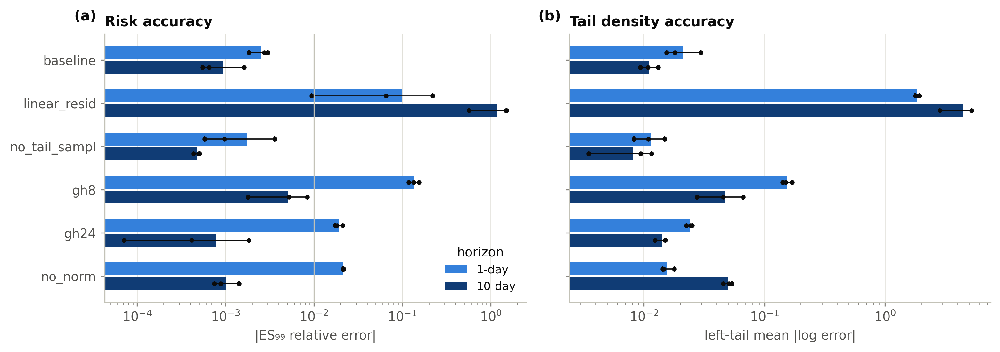
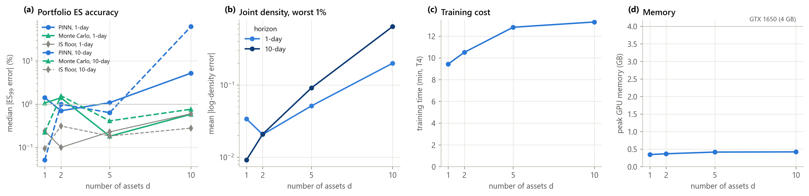
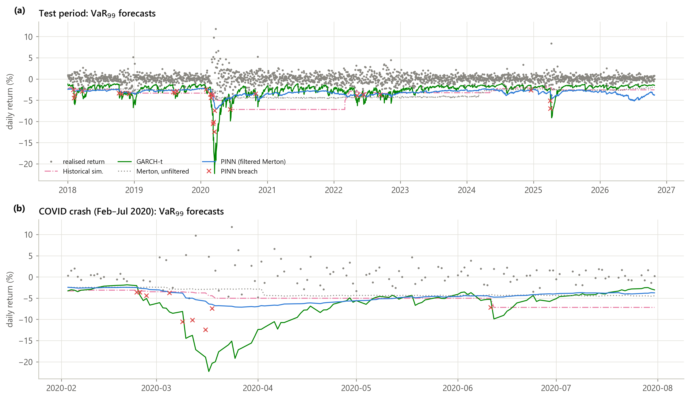
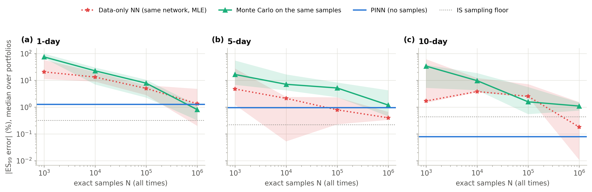
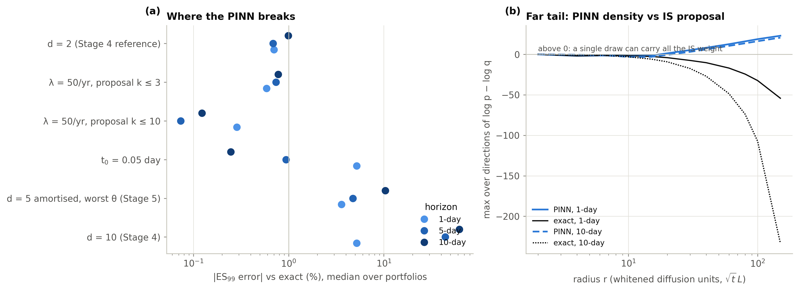
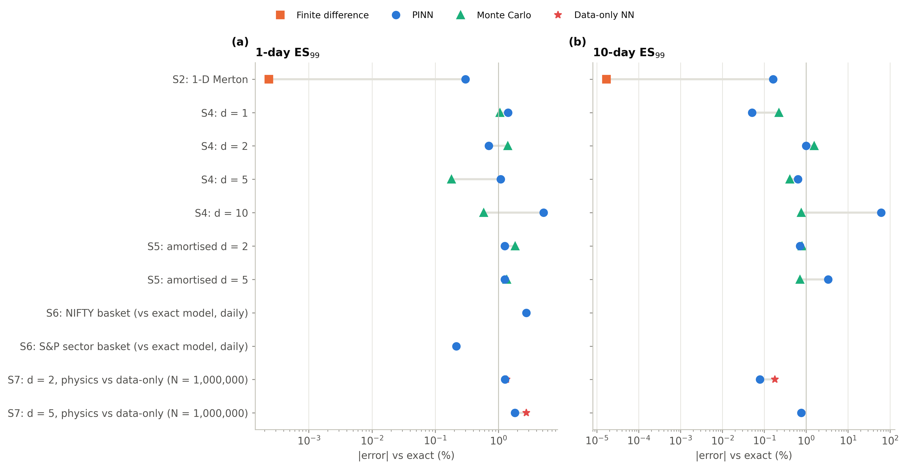

# Physics-Informed Neural Networks for Financial Tail-Risk Estimation

**VaR and Expected Shortfall from PINN-solved densities under jump-diffusion dynamics:
from a validated one-dimensional study to multi-asset, amortised and real-data tail risk.**

M.Tech research project · Aditya Siraskar, Utkarsh Sinha, Aditya Sharma · Mentor: Dr. Jaykrishna Joshi

[Thesis draft](thesis/) · [Notebooks](notebooks/) · [Research plan](PLAN.md)

---

## At a glance

| Question | Finding |
|---|---|
| Can a PINN learn the *tail* of a return density, not just its bulk? | Yes. With a log-form residual, VaR and ES are within **1%** of exact in 1-D and up to **5 assets**. |
| Does it scale with the number of assets? | Up to **d = 5** at roughly constant cost (10–14 min on a T4). It **breaks at d = 10**. |
| Is it faster than Monte Carlo? | **No, for the Merton model.** One amortised network answers queries in 4–18 ms, but Monte Carlo is faster at equal error. |
| Does it work on real data? | It reproduces its model to **0.2–2.8%** daily ES on NIFTY and S&P baskets (2018–2026). The backtests then reflect the model: better than Gaussian/HS, behind GARCH/EVT/FHS. |
| What is the physics worth? | Trained on **no samples**, the PINN matches the same network trained on **10⁵–10⁶ exact samples**. |

---

## 1. Motivation

Risk managers care about the worst days, not the average ones. Regulation follows: under the Basel
*Fundamental Review of the Trading Book*, market-risk capital is set by the **97.5% Expected Shortfall**.
Both VaR and ES are properties of the tail of the loss distribution, and returns have fat tails, volatility
clusters and sudden jumps. A model can fit the centre of the distribution well and still misjudge the worst 1%.

Jump-diffusion models capture these features. Their return density solves a forward **partial
integro-differential equation (PIDE)**, and once the density is known, VaR is a quantile and ES a tail integral.
The classical ways to get the density each fail somewhere:

- **Finite differences** are accurate but their cost grows as *n*<sup>d</sup>, so they stop at two or three assets.
- **Monte Carlo** works in any dimension but converges as *N*<sup>−1/2</sup> in the tail and has to be rerun for
  every new parameter set.

**Physics-informed neural networks** offer a third route: a mesh-free network trained to satisfy the equation
itself, which can take market parameters as inputs and is evaluated by a single forward pass.

### Research aim

> *When does a PINN give better tail-risk estimates than conventional methods, and when does its overhead
> outweigh the gain?*

The goal is not to show that PINNs win. It is a controlled test with an **exact ground truth at every step**,
strong numerical and statistical baselines, and honest accounting of cost, in which a negative result is as
informative as a positive one.

| | Research question |
|---|---|
| **RQ1** | Bulk vs tail: how accurately is the density recovered in its tail, separately from its bulk? |
| **RQ2** | Risk accuracy and calibration: VaR/ES against exact values, and backtests on real multi-asset data. |
| **RQ3** | Does the physics help? The PINN against the same network trained on data alone. |
| **RQ4** | Scaling with dimension: d = 1 → 10, against finite differences and Monte Carlo. |
| **RQ5** | Latency: per-query cost against Monte Carlo at equal tail error, and the break-even query count. |

---

## 2. Model

Log returns follow a **Merton jump-diffusion**; in *d* dimensions the assets share **one market-jump factor**:

```
dX_t = a dt + Σ^{1/2} dW_t + β dJ_t,      J_t = Σ_{i ≤ N_t} Y_i,   N_t ~ Poisson(λt),   Y ~ N(μ_J, σ_J²)

∂p/∂t = −a·∇p + ½ tr(Σ ∇²p) + λ ∫ p(x − βy, t) f_Y(y) dy − λ p          (forward PIDE)
```

Two properties make this model the right testbed:

- **Exact ground truth in any dimension.** The density is a Poisson mixture of Gaussians, so every error in this
  project is *measured*, not estimated. For linear portfolios, `w·X` is itself a 1-D Merton process, which gives
  exact VaR/ES for every portfolio.
- **A tractable jump integral.** With a common jump the integral is one-dimensional for any *d*, so it can be
  computed by Gauss–Hermite quadrature.

---

## 3. Methodology

### PINN design

| Component | Choice | Why |
|---|---|---|
| Output | **log-density** *u* = log *p* plus the known Gaussian normaliser | Positive by construction; tail densities of 10⁻⁴ become O(1) targets |
| Inputs | whitened similarity variable *z* = L⁻¹(x − at)/√t, scaled log *t* | The diffusive bulk has unit width at every time |
| Residual | **log-form**: the PIDE divided by *p*, multiplied by *t* | Measures *relative* error, so a tail point weighs as much as a bulk point |
| Jump integral | 48-node Gauss–Hermite quadrature along β | Sets short-horizon accuracy (see the ablations) |
| Start | *t*₀ = 0.5 day from the exact density | Avoids the Dirac delta at *t* = 0 |
| Normalisation | penalty on (log ∫ *p*)², by importance sampling | The log residual is blind to scaling *p* |
| Laplacian (d dims) | exact for d ≤ 4, **Hutchinson** estimator above | Cost independent of *d* |
| Sampling | one **Student-t jump-mixture proposal** built from the PIDE coefficients | No grid: collocation, normalisation and VaR/ES all use it |
| Risk | self-normalised **importance sampling**, one set of draws for every portfolio | Risk contributions ∂ES/∂wᵢ follow from the same draws |

### Seven stages, each validated before the next

```
 Stage 1  Literature review ─────────────────────────────────────────────── gap
 Stage 2  1-D: exact / FD / MC references → 1-D PINN → ablations (3 seeds) ── design fixed
 Stage 3  Multi-asset ground truth: closed form, 2-D ADI finite differences ── reference
 Stage 4  d-asset PINN, d = 1, 2, 5, 10 ────────────────────────────────── RQ1, RQ4
 Stage 5  Amortised PINN over θ = (vol scale, λ, μ_J); latency vs MC ──────── RQ5
 Stage 6  NIFTY and S&P baskets, 2018–2026: daily backtests vs 7 models ───── RQ2
 Stage 7  Physics vs data-only network; failure cases; scorecard ──────────── RQ3
```

### Evaluation protocol

- **Error.** Relative ES₉₉ error at 1, 5 and 10 days, median over 20 portfolios per dimension (equal-weight,
  15 long-only, 4 long–short). Density error is reported separately for the bulk and the 1% tail.
- **Sampling controls on common draws.** Each comparison includes the *same estimator with the exact density*
  (the importance-sampling floor) and *Monte Carlo at the same budget*, so the differences are model differences.
- **Backtests.** Kupiec (coverage), Christoffersen (independence), the FZ0 joint VaR–ES score (Patton, Ziegel &
  Chen, 2019) and Diebold–Mariano tests against the PINN.
- **Benchmarks.** Gaussian, historical simulation, filtered HS, GARCH(1,1)-t, GARCH-EVT, DCC-GARCH-t and an
  unfiltered Merton model, on a linear basket and on an option book (basket + short 3%-OTM put).

---

## 4. Results

### Stage 2: the 1-D PINN learns the tail

Every VaR and ES from 95% to 99.9% is within **1%** of exact (ES₉₉: 0.30 / 0.42 / 0.16% at 1 / 5 / 10 days).
The ablations show that three design choices matter:

| Variant (3 seeds) | ES₉₉ error, 1 day | ES₉₉ error, 10 days |
|---|---|---|
| **Full design** | **0.18–0.30%** | **0.06–0.16%** |
| Standard residual on *p* (not log *p*) | 0.9–22% | 57–152% |
| 8 quadrature nodes (instead of 48) | 12–15% | 0.2–0.8% |
| No normalisation penalty | 2.1–2.2% | 0.07–0.14% |
| No tail-adaptive sampling | 0.06–0.36% | 0.04–0.05% |

> **Inference.** The **log-form residual** is what makes a PINN usable for tail risk; the standard residual weights
> the tail by its tiny density and ignores it. Tail-adaptive sampling, a common recommendation, gives no gain.

<p align="center"></p>

### Stage 4: scaling with dimension (RQ1, RQ4)

| d | PINN ES₉₉ 1 d / 10 d | Monte Carlo (same N) | Tail log-density error | Training (T4) |
|---|---|---|---|---|
| 1 | 1.4% / 0.05% | 1.1% / 0.22% | 0.03 | 9.4 min |
| 2 | 0.7% / 1.0% | 1.4% / 1.6% | 0.02 | 10.5 min |
| 5 | 1.1% / 0.6% | 0.2% / 0.4% | 0.05 | 12.8 min |
| 10 | **5.2% / 62%** | 0.6% / 0.8% | 0.20 | 13.3 min |

> **Inference.** Up to five assets the PINN stays near 1% with almost flat training cost, a regime where grid
> solvers are already impractical (a 2-D grid takes 55 s, against 0.3 s in 1-D). At d = 10 the PDE loss stalls and
> the density is too wide along the jump direction. We report this as the **breakdown point** rather than tune
> around it.

<p align="center"></p>

### Stage 5: one network for a whole range of markets (RQ5)

A single network with inputs θ = (vol scale *s* ∈ [0.6, 1.6], λ ∈ [1, 15]/yr, μ_J ∈ [−0.10, −0.02]) gives a median
ES₉₉ error of **1.3 / 0.8 / 0.7%** at d = 2 (Monte Carlo at the same N: 1.8 / 0.9 / 0.8%). At d = 5 the error rises
to 3.4% at 10 days, with 10% in the worst corner of the box. Euler risk contributions agree with finite differences
of the exact ES to within about 5%.

> **Inference.** Amortisation works: one training run replaces a retrain per market state, and sensitivities come by
> differentiation. **Latency does not favour the PINN here.** Monte Carlo takes 0.9–1.6 ms per query against 4–18 ms
> for the PINN, so there is no break-even, because exact Merton simulation is cheap. A speed advantage needs a model
> that is expensive to simulate.

### Stage 6: real data, 2018–2026 (RQ2)

Five-asset baskets: **NIFTY** (Reliance, HDFC Bank, Infosys, ICICI Bank, TCS) and **S&P sector ETFs** (XLK, XLF, XLE,
XLV, XLI). The models are developed on 2006–2017 and tested from January 2018 (about 2,200 days, including COVID).
The PINN is the amortised model, queried once a day at the day's calibrated parameters.

| 99%, linear basket | NIFTY: breaches · Kupiec p · FZ0 | S&P: breaches · Kupiec p · FZ0 |
|---|---|---|
| DCC-GARCH-t | 28 · 0.20 · **−3.301** | 33 · 0.03 · −3.294 |
| Filtered HS | 19 · 0.54 · −3.278 | 20 · 0.64 · −3.244 |
| GARCH-EVT | 26 · 0.38 · −3.201 | 20 · 0.64 · **−3.353** |
| **PINN** | 15 · 0.12 · −3.156 | 27 · 0.32 · −3.046 |
| Merton, exact density | 15 · 0.12 · −3.134 | 27 · 0.32 · −3.044 |
| Historical simulation | 26 · 0.38 · −3.016 | 30 · 0.11 · −2.731 |
| Gaussian | 38 · 0.002 · −2.881 | 59 · <0.001 · −2.297 |

*Expected breaches at 99%: about 22. FZ0: lower is better.*

> **Inference.** The PINN is a **faithful surrogate** of its model: its daily ES is within 0.2–2.8% (median) of the
> exact density, with identical breaches. Its backtest performance is the model's. It passes coverage at 99% and
> beats Gaussian, HS and unfiltered Merton, but it is conservative at 97.5% and ranks behind volatility-filtered
> models with fat-tailed innovations. On real data, **model choice mattered more than network error.**

One day (S&P, 2022-06-16) exposed a failure: a single importance draw about 100σ out took all the weight, because the
network was never trained there. A **trust region** (draws more than 6 radii from the training region get zero
weight; exact mass removed < 10⁻¹⁵) fixes it. The cause is examined in Stage 7.

<p align="center"></p>

### Stage 7: what is the physics worth? (RQ3)

The PINN is compared with an **identical network** (same architecture, optimiser, schedule, steps and normaliser),
trained by maximum likelihood on *N* exact samples, and with Monte Carlo on the same samples.

| d = 2, ES₉₉ error | 1 day | 5 days | 10 days |
|---|---|---|---|
| **PINN (no samples)** | **1.3%** | **0.9%** | **0.08%** |
| Data-only NN, N = 10⁴ | 13% | 2.1% | 3.8% |
| Data-only NN, N = 10⁵ | 5.0% | 0.8% | 2.5% |
| Data-only NN, N = 10⁶ | 1.3% | 0.4% | 0.18% |
| Monte Carlo, same 10⁶ samples | 0.8% | 1.2% | 1.1% |

> **Inference.** The equation is worth **10⁵–10⁶ exact samples** (similarly at d = 5). With the few thousand daily
> observations available in practice, a data-only network is 5–60% off. When the model is known one can always
> simulate, so the PINN's real advantage is a smooth, normalised, differentiable density over all times and
> parameters, at no sampling cost per query.

<p align="center"></p>

### Where it breaks

| Failure case (d = 2 unless noted) | ES₉₉ error 1 / 5 / 10 days | Verdict |
|---|---|---|
| Crisis jump rate λ = 50/yr, proposal covers ≤ 3 jumps | 0.6 / 0.7 / 0.8% | Degrades, does not break |
| Same, proposal widened to ≤ 10 jumps | 0.3 / 0.07 / 0.12% | Fixed by a setting |
| Start time *t*₀ = 0.05 day (10× sharper start) | **5.2%** / 0.9 / 0.25% | Fails at short horizons |
| Amortised d = 5, worst θ | 3.6 / 4.7 / **10%** | Degrades with horizon |
| d = 10 | 5.2 / **44 / 62%** | Breakdown |

> **Inference.** Outside its training region the network's density decays *more slowly* than the heavy-tailed
> proposal (log p − log q turns positive beyond about 20 whitened units, while the exact one falls to −230). **A
> neural density must not be trusted where it was never trained**, so importance-sampling estimates need a trust
> region.

<p align="center"></p>

### Scorecard across all stages

<p align="center"></p>

---

## 5. Conclusions

1. **Design over capacity.** Writing the residual for the log density, resolving the jump integral and normalising
   each change tail error by an order of magnitude. Network size does not.
2. **Mesh-free scaling works to five assets** at about 1% ES error and almost constant training cost. It breaks at
   ten, which we report as the limit of this architecture and budget.
3. **The physics replaces 10⁵–10⁶ samples**, a decisive advantage when data are scarce.
4. **Speed is not the selling point for Merton.** The PINN's value is a differentiable, amortised density for
   sensitivities, scenarios and models that are expensive to simulate.
5. **On real data the model dominates.** A PINN faithfully reproduces whatever model it is given, so better tail
   forecasts need better models, not better networks.

**Limitations.** One common jump factor (idiosyncratic jumps untested); volatility only as a daily scale; no
stochastic volatility; d = 10 unsolved; the exact short-time density is used as the initial condition.

**Future work.** Stochastic volatility (Bates) and Hawkes jumps, where simulation is costly and the PINN could win on
latency; time-marching and low-rank networks beyond d = 10; option-implied calibration; uncertainty quantification
to flag extrapolation automatically.

---

## 6. Reproducing the results

### Setup

```bash
py -3.11 -m venv .venv
.venv/Scripts/pip install torch --index-url https://download.pytorch.org/whl/cu126
.venv/Scripts/pip install -e .[dev]
.venv/Scripts/python -m pytest          # 28 tests: exact densities, solvers, PINN residual, data-only loss
```

GPU runs use a free T4 in **Google Colab or Kaggle**. Each notebook in [`notebooks/`](notebooks/) has an
*Open in Colab* and an *Open in Kaggle* badge and runs one stage end to end. All training runs fit in under 0.5 GB of
GPU memory.

| Stage | Command | Output | T4 time |
|---|---|---|---|
| 2a Ground truth (exact, FD, MC) | `python scripts/stage2_reference.py` | `figures/stage2_reference/` | < 1 min |
| 2b 1-D PINN | `python scripts/stage2_pinn1d.py [--seed N --tag name]` | `figures/stage2_pinn1d/` | 9 min |
| 2b figures only | `python scripts/replot_pinn1d.py [--tag name]` | fig01, fig04, fig05 from saved results | – |
| 2c Ablations (3 seeds) | notebook `03_phase1_stage2c_ablations` | `figures/stage2_ablation/` | ~2.5 h |
| 3 Multi-asset ground truth | `python scripts/stage3_multiasset_reference.py` | `figures/stage3_multiasset_reference/` | ~2 min |
| 4 d-asset PINN | `python scripts/stage4_pinn_nd.py --d D [--trace exact --tag exact]` | `figures/stage4_pinn_nd_d<D>/` | 9–14 min |
| 4 Scaling summary | `python scripts/stage4_summary.py` | `figures/stage4_summary/` | – |
| 5 Amortised, real-time | `python scripts/stage5_amortised.py --d D [--eval-only]` | `figures/stage5_amortised_d<D>/` | 18–22 min |
| 6 Real data, backtests | `python scripts/stage6_realdata.py --market nifty\|sp [--eval-only]` | `figures/stage6_realdata_<market>/` | ~25 min |
| 7 Physics vs data-only | `python scripts/stage7_ablation.py --part data --d 2\|5` | `figures/stage7_physics_vs_data_d<D>/` | ~40 min |
| 7 Failure cases | `python scripts/stage7_ablation.py --part failure --case high_lam\|high_lam_kfix\|tiny_t0` | `figures/stage7_failure_<case>/` | ~10 min |
| 7 Scorecard | `python scripts/stage7_ablation.py --part summary` | `figures/stage7_final/` | < 1 min |

Every script reads a YAML config from [`configs/`](configs/) and writes `figures/<stage>/*.{pdf,png}` (PDF for the
thesis, PNG for slides) and `results/<stage>/metrics.json`, stamped with the git commit, library versions and device.
Real-data log returns are committed in `data/processed/`, because Yahoo revises adjusted prices.

### Repository layout

```
pinn_tailrisk/        library (imported by scripts and notebooks)
  jumpdiff.py         Merton model: exact density, VaR/ES, simulation (1-D and d-asset common jump)
  fd.py / fd2d.py     finite-difference PIDE solvers (CN-AB2 IMEX in 1-D; Douglas ADI in 2-D; FFT jump convolution)
  pinn.py             1-D PINN: log residual, Gauss-Hermite jumps, normalisation, tail-adaptive sampling
  pinn_nd.py          d-asset PINN: whitened inputs, exact/Hutchinson trace, jump-mixture proposal, IS VaR/ES
  pinn_amortised.py   amortised PINN over (s, λ, μ_J); IS trust region; torch Monte Carlo for latency
  data_only.py        Stage 7 baseline: the same network fitted to samples by maximum likelihood
  calibrate.py        maximum likelihood of the d-asset model with a daily EWMA vol scale
  benchmarks.py       Gaussian, HS, filtered HS, GARCH-t, GARCH-EVT, DCC-GARCH-t
  backtest.py         Kupiec, Christoffersen, FZ0 score, Diebold-Mariano
  data.py, risk.py    data download and returns; VaR/ES from grids, samples and weights
  plotting.py         project-wide figure style: one fixed color + linestyle per method
configs/              one YAML per experiment (base.yaml = shared ground truth)
scripts/              one script per stage
notebooks/            Colab/Kaggle notebooks, one per stage (generated by tools/make_notebooks.py)
figures/, results/    every figure and metric in the thesis
thesis/               LaTeX thesis draft (main.tex, chapters/, references.bib)
tests/                pytest suite
```

### Figure conventions

One categorical palette, checked for colour-vision deficiency, with each method fixed across the whole project:
Exact = black dashed, PINN = blue, Finite difference = orange, Monte Carlo = aqua, Gaussian = yellow dotted,
Historical sim. = magenta, GARCH-t = green, EVT = violet, Data-only NN = red. Every method also has its own linestyle
and marker, so figures stay readable in grayscale print.

---

## Authors

**Aditya Siraskar, Utkarsh Sinha, Aditya Sharma**

M.Tech Research Project
